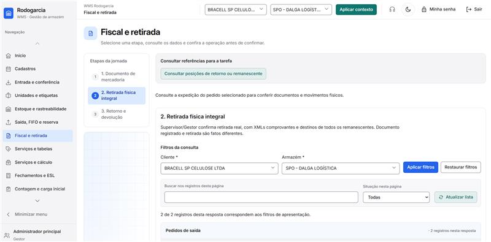

# Alinhamento fiscal com as respostas do gestor

Respostas encaminhadas em 22/10/2026 para complementar o levantamento de Fiscal e retirada. Emitente, destinatário, agrupamento, valor, sequência de desistência e possibilidade de operação apenas fiscal foram esclarecidos em duas rodadas. Permanece uma validação fiscal específica: o cancelamento informado para mercadoria que já circulou não deve ser tratado como automaticamente admissível só por ocorrer dentro de 24 horas.

Esta atualização é documental. Não houve alteração de código, configuração ou banco, emissão de NF-e ou cancelamento externo. As respostas são fonte de negócio; os DANFEs são exemplos de operações específicas e não instruções de execução ou parâmetros universais.

## Respostas recebidas e aplicação

| Tema | Resposta do gestor | Aplicação no levantamento |
| --- | --- | --- |
| Emitente | A nota é emitida pelo CNPJ do armazém onde ocorreu a entrada; a entrada fiscal foi destinada a ele e a saída deve ocorrer pelo mesmo armazém. | Vincular o estabelecimento da saída à origem efetiva da mercadoria. Não escolher emitente pelo proprietário, por outra filial selecionada ou por padrão global. |
| Destinatário | Sempre o proprietário da mercadoria. | O proprietário já identificado na entrada e no pedido é o destinatário fiscal. Um terceiro não substitui esse destinatário neste escopo. |
| Tipo da operação | Usualmente Retorno de mercadoria depositada em depósito fechado ou armazém, sempre com saída física na prática descrita. O tratamento depende da maneira como o cliente emitiu a entrada. | Preparar o retorno correspondente à operação de origem. Isso não significa copiar literalmente CFOP, direção ou todos os tributos da nota de entrada. Tratar por operação e cliente, com parametrização fiscal validada. |
| Agrupamento | Segue o critério do cliente, podendo reunir ou separar notas de origem. Bracell pode ter uma nota de saída com várias entradas. | Parametrização por cliente e plano documental compatível. A consolidação não apaga origem, quantidade ou valor de cada parcela; não obrigar Bracell a uma nota por entrada. |
| Valor | Usar o valor da entrada, proporcional à quantidade retirada, inclusive no parcial de pallet. | Congelar valor e quantidade da origem efetivamente usada, calcular a proporção da parcela e conservar o saldo. A aprovação agora é específica para a saída fiscal; não depende mais de inferir a regra dos indicadores. |
| Desistência em até 24 horas | É possível cancelar a NF-e e cancelar a operação de saída por completo. | Registrar o prazo operacional informado, mas não interpretá-lo como permissão de cancelamento se a mercadoria já circulou. Cancelamento depende de resultado fiscal confirmado, não apenas de clicar ou de transcorrer prazo. |
| Desistência depois de 24 horas | Emitir nota para dar entrada novamente no armazém. | Novo caminho de regularização fiscal, diferente de marcar a nota original como cancelada. Seu efeito no estoque depende da existência de saída e retorno físicos, conforme a matriz abaixo. |

As quatro primeiras dúvidas do levantamento inicial ficam resolvidas nesses limites. Dados de credenciamento, XML completo, tributação por estabelecimento e ambiente de homologação são insumos de execução a obter pelos canais técnicos/fiscais, não novas perguntas genéricas ao gestor.

### Complemento confirmado na segunda rodada

| Situação perguntada | Resposta recebida | Consequência para o desenho |
| --- | --- | --- |
| Mercadoria saiu e voltou dentro de 24 horas | Cancelar a nota de saída e a saída fiscal; somente reendereçar a mercadoria, sem emitir nota de entrada nesse procedimento informado. | Reendereçamento precisa de mercadoria efetivamente presente e de resolução fiscal confirmada/admissível. Preservar os fatos e o vínculo da reversão no histórico; validar com Natalina a hipótese de cancelamento após circulação. |
| Mais de 24 horas, mesmo sem retirada | Nota de entrada regulariza físico e fiscal; tratar como entrada nova e exigir reendereçamento, mesmo sem ter saído. | Abrir novo processo de entrada/regularização e encaminhar a endereçamento. Para mercadoria ainda presente, reaproveitar a quantidade real com vínculos entre os ciclos, sem acrescentar uma segunda cópia ao estoque. |
| Responsabilidade e ordem | Fiscal atua primeiro; depois o operador realiza endereçamento. | A etapa fiscal precede a execução operacional. Documento/processamento fiscal pendente ou recusado não equivale a liberação para concluir a regularização. |
| Retorno simbólico | Pode ser operação somente fiscal. | Documento simbólico tem acompanhamento próprio e não comanda retirada, baixa ou entrada física por si só. |

Essas respostas substituem as hipóteses operacionais apresentadas na primeira rodada. Não é necessário perguntar novamente ao gestor se existe operação apenas fiscal nem quem atua primeiro. A resposta sobre cancelamento após circulação é registrada como procedimento informado, com a validação fiscal delimitada adiante.

## Exemplos de nota conferidos

Os arquivos mencionados como Desktop foram localizados em Downloads. Foram lidos integralmente, extraídos e renderizados para conferência visual. As cópias de referência preservam os bytes dos originais; hashes e verificações estão no [registro documental](levantamentos/fiscal-notazz-20261022/conferencia-exemplos-gestor.json).

| Informação | [NF-e 319](referencias/notazz-exemplos-20261022/NF-41260904547874000203550000000003191000001871.pdf) | [NF-e 316](referencias/notazz-exemplos-20261022/NF-41260904547874000203550000000003161000001845.pdf) |
| --- | --- | --- |
| Data impressa | 30/09/2026 | 29/09/2026 |
| Emitente | DALGA LOGISTICA E TRANSPORTES LTDA, CNPJ 04.547.874/0002-03, Castro PR | Mesmo estabelecimento |
| Destinatário | TIGRE, CNPJ 33.064.262/0002-50, Castro PR | Mesmo destinatário |
| Série | 000 | 000 |
| Natureza impressa | Retorno de mercadoria depositada em deposito fechado ou arma, texto abreviado no DANFE | Mesmo texto abreviado |
| CFOP observado | 5906 | 5906 |
| Produto | 69230624, BANDEJA AZUL 230MM 77726045 | 69230424, BANDEJA PRETA 230MM 77726511 |
| NCM e O/CST impressos | 39269090 e 041 | 39269090 e 041 |
| Quantidade e unidade | 16.000 PC | 32.000 PEC |
| Valor unitário e total | R$ 0,7100 e R$ 11.360,00 | R$ 0,7000 e R$ 22.400,00 |
| Volumes e peso | 13 paletes; bruto/líquido 13.000 kg | 26 paletes; bruto/líquido 26.000 kg |
| Nota de entrada referenciada | 293732, série 1, de 01/09/2026; chave impressa | 293729, série 1, de 01/09/2026; chave impressa |
| PIS e COFINS impressos | R$ 73,84 e R$ 340,80 | R$ 145,60 e R$ 672,00 |
| ICMS e IPI impressos | Zero nos campos mostrados | Zero nos campos mostrados |
| Frete | Modalidade 9, sem frete | Modalidade 9, sem frete |

Os totais dos produtos conferem com quantidade multiplicada pelo valor unitário. As chaves têm 44 dígitos, dígito verificador coerente, CNPJ emissor e numeração correspondentes. Isso não substitui consulta da situação fiscal atual. Os protocolos são os impressos no PDF, não resultados de consulta nova.

Ambos foram gerados pela Notazz e incluem referência à nota de origem e uma referência externa nas observações. Isso demonstra uso de informação de rastreabilidade, sem provar vínculo com um pedido específico deste WMS. As datas diferentes não demonstram retirada física parcial do mesmo pedido: as datas das notas e da coleta são fatos distintos.

### Limites dos exemplos

Os exemplos são de Tigre em Castro, com uma nota de entrada referenciada em cada saída. Não demonstram a operação Bracell com várias origens, retorno simbólico, cancelamento ou nota de regularização/entrada. A possibilidade de consolidar Bracell vem da resposta expressa, não desses PDFs.

CFOP 5906, O/CST 041, NCM, série, frete, pesos e valores observados não serão aplicados automaticamente a outros produtos, clientes ou estabelecimentos. Os PDFs mostram PIS/COFINS positivos: ICMS e IPI zerados não autorizam zerar todos os tributos. A decomposição tributária e os campos não impressos devem ser obtidos do XML e do cadastro fiscal aplicável.

PC e PEC aparecem em produtos diferentes; os documentos não aprovam uma equivalência geral entre essas grafias. Paletes, peso e quantidade de peças continuam distintos. Não deduzir peso padrão de pallet nem conteúdo de embalagem a partir desses dois exemplos.

## Conservação do valor por origem

Para uma origem conhecida, a parcela fiscal usa o valor de entrada proporcional à quantidade efetivamente retirada dessa origem. Quando um SKU reúne origens com preços diferentes, preservar a composição em linhas/parcela de origem; não usar preço médio que atribua o valor de outra entrada à mercadoria selecionada.

Exemplo de análise: retirar 80 unidades de origem a R$ 2,00 e 20 de origem a R$ 3,00 totaliza R$ 220,00. Uma nota consolidada pode representar ambas sem perder as referências. Isso é independente de o pedido ter apenas um item do SKU no cadastro operacional.

O cálculo deve usar precisão decimal e controlar o arredondamento para que retiradas sucessivas mais saldo conservem o valor original. Exemplo de conservação: valor R$ 100,00 dividido em três quantidades iguais não pode terminar em R$ 99,99 ou R$ 100,02. A regra de rateio e a precisão efetiva do XML serão verificadas no contrato fiscal; o gestor não precisa escolher tipos numéricos ou detalhes de programação.

## Desistência e regularização fiscal

O prazo informado é uma condição do procedimento de negócio, não prova suficiente para decidir a movimentação. A cláusula décima segunda do [Ajuste SINIEF 7/05](https://www.confaz.fazenda.gov.br/legislacao/ajustes/2005/AJ007_05) condiciona o cancelamento comum à ausência de circulação da mercadoria e às demais condições aplicáveis, contando o prazo da autorização. A resposta não deve ser convertida em cancelamento automático de toda saída ocorrida há menos de 24 horas. Regras específicas e enquadramento da regularização ficam com o fiscal responsável.

| Situação real | Efeito físico e histórico a preservar | Tratamento fiscal informado ou pendência |
| --- | --- | --- |
| Nota autorizada, mercadoria ainda no armazém, desistência dentro do prazo informado | Não houve baixa física. Retorno da separação às posições deve ser confirmado, mantendo origem e histórico. | Cancelar documento conforme admissibilidade e confirmação do emissor; cancelar pedido integralmente depois de resolver o conjunto. |
| Mais de 24 horas, mercadoria nunca saiu | Novo processo de entrada/regularização, seguido de reendereçamento, conforme resposta expressa. A quantidade física real continua única; os vínculos entre ciclos explicam a regularização sem trânsito. | Fiscal emite a nota de entrada e resolve sua etapa; operador endereça depois. Não tratar a operação como simples troca de texto sem processo de entrada, nem duplicar mercadoria por ela continuar no depósito. |
| Mercadoria saiu e voltou dentro de 24 horas | Procedimento informado: resolver a saída fiscal e reendereçar a quantidade efetivamente retornada, sem nota de entrada nessa via. Preservar fatos de saída/retorno e sua correção por registros vinculados, sem apagar história. | Gestor especificou cancelamento da nota de saída. A admissibilidade após circulação precisa ser validada por Natalina; o prazo isolado não autoriza envio automático de cancelamento. |
| Mercadoria saiu e voltou depois de 24 horas | Nova entrada/regularização e reendereçamento da quantidade realmente retornada, com vínculo à origem e à saída. | Fiscal primeiro; operação depois. Conservar identidade de origem, histórico e saldo uma única vez. |
| Mercadoria saiu e ainda não retornou | Não recompor estoque disponível apenas por documento ou desistência comunicada. | Acompanhar pendência fiscal e física; nova chegada depende do retorno efetivo. |
| Cancelamento solicitado foi recusado ou ficou sem confirmação | Não marcar cancelado, liberar saldo ou apagar saída por antecipação. | Consultar o resultado e encaminhar regularização aplicável. |

### Impacto no contrato atual

O retorno interno atual exige que os documentos ativos estejam localmente cancelados. A resposta posterior ao prazo acrescenta um cenário em que a NF-e original pode continuar autorizada e ser regularizada por outro documento. A implementação futura precisará reconhecer esse vínculo de regularização e sua cobertura, preservando a situação real de cada nota. Não simular CANCELADO apenas para satisfazer a regra antiga do retorno interno.

O complemento exige novo processo operacional de entrada após o prazo, inclusive sem trânsito externo. Isso substitui a hipótese anterior de uma regularização apenas documental nesse caso. O processo deve distinguir mercadoria já presente de mercadoria realmente retornada, vincular ciclos e quantidades e exigir novo endereçamento, sem duplicar o saldo. A expressão entrada nova não autoriza apagar a origem histórica, alterar FIFO original ou inventar serviço executado; datas e fatos de cada ciclo devem registrar o que de fato ocorreu.

## Validação fiscal específica ainda necessária

A regra operacional está esclarecida. O gestor informou cancelamento da nota de saída mesmo quando a mercadoria já saiu e voltou dentro de 24 horas. A cláusula décima segunda do Ajuste SINIEF 7/05 condiciona o cancelamento comum à ausência de circulação, além das demais condições. Portanto, a resposta não comprova por si a admissibilidade fiscal dessa hipótese.

Natalina/Controladoria deve validar o enquadramento aplicável e o documento/evento aceito nesse caso concreto. O sistema deve preservar a distinção entre solicitar cancelamento e ter cancelamento autorizado, sem liberar regularização com base apenas no relógio ou simular evento recusado. Esta pendência não exige nova explicação genérica de operação pelo gestor e não impede o mapeamento independente dos demais caminhos.

Os parâmetros técnicos e tributários seguem pelo XML, emissor e Controladoria. Emitente, destinatário, valor proporcional, agrupamento Bracell, novo processo de entrada após o prazo, ordem fiscal antes de operação e possibilidade de retorno somente fiscal têm resposta expressa e não devem ser reabertos como dúvidas genéricas.

### Pesquisa oficial para esgotar a dúvida

Em 22/10/2026, a pesquisa adicional confirmou que a condição nacional do cancelamento comum é ausência de circulação, além do prazo e das demais condições. O retorno no mesmo dia não elimina a circulação que efetivamente ocorreu. Fonte: cláusula décima segunda do [Ajuste SINIEF 7/05](https://www.confaz.fazenda.gov.br/legislacao/ajustes/2005/AJ007_05).

A [orientação de cancelamento extemporâneo da SEFAZ/SP](https://portal.fazenda.sp.gov.br/servicos/nfe/Paginas/cancelamentoextemp.aspx/1000) também exclui esse caminho quando houve circulação. Portanto, admitir prazo maior não resolve por si esse impedimento. Não se transportam os prazos paulistas automaticamente para outro estabelecimento.

Há procedimentos próprios para retorno: a [consulta paulista 21291/2020](https://legislacao.fazenda.sp.gov.br/Paginas/RC21291_2020.aspx) trata especificamente de recusa com retorno ao armazém geral, envolvendo documentos do depositante. É cenário distinto da retirada pelo proprietário descrita neste projeto; não copiar seu emitente ou CFOP para a Rodogarcia.

O [Ajuste SINIEF 49/25](https://www.confaz.fazenda.gov.br/legislacao/ajustes/2025/AJ049_25), cláusula quinta, também disciplina documentos de retorno por recusa/não localização. A redação consultada distingue retorno total e parcial; a cláusula quinta-A fixa a obrigação de seguir o ajuste a partir de 01/01/2027. Verificar vigência, transição e aderência ao fato real na implementação, sem transformar esse texto em configuração universal ou obrigatoriedade antecipada.

**Conclusão da pesquisa:** a regra geral foi encontrada; resta conciliar o procedimento informado com o caso real do armazém. O encaminhamento ao gestor deve pedir que Natalina confirme qual documento registra a volta quando a carga efetivamente deixou o estabelecimento, pois o cancelamento comum pressupõe ausência de circulação. Não perguntar novamente se o retorno simbólico pode ser apenas fiscal nem repetir o questionário já respondido. [Fontes, alcance e limites](levantamentos/fiscal-notazz-20261022/pesquisa-cancelamento-circulacao.json).

## Comparação visual antes e depois

O antes é a captura original fornecida pelo responsável. O depois é uma proposta ilustrativa gerada com a ferramenta integrada de imagens, com dados fictícios. Mantém a identidade visual do WMS e mostra a opção única, tabela fiscal, várias notas quando necessário, conferência de emissão e confirmação física separada. Não é captura de uma funcionalidade já implementada; a composição final será validada na implementação.

**Antes**

**Depois proposto**

O cartão de conferência ilustra o conteúdo apresentado depois de escolher emitir; sua presença abaixo da lista não fixa o uso de cartão em vez de diálogo na implementação final. A imagem retrata a emissão/retirada principal. Os caminhos de regularização e retorno apenas fiscal serão detalhados conforme as respostas complementares, preservando a validação fiscal específica acima. [Descrição e prompt da prévia](levantamentos/fiscal-notazz-20261022/visual/descricao-previa-visual.txt).

## Verificações desta atualização

Foram feitas 30 conferências documentais e exercícios aritméticos independentes, todos compatíveis com o esperado, incluindo chaves dos dois DANFEs, identidade, totais, distinção de medidas e conservação do rateio. [Resultado e limites](levantamentos/fiscal-notazz-20261022/conferencia-exemplos-gestor.json).

Essas verificações não executam emissão, cancelamento, estoque ou código da aplicação. Os 68 testes frontend da rodada anterior conservam sua data e seu escopo. Os cenários novos do [documento 48](48-cenarios-e-validacao-fiscal-notazz.md) permanecem planejados. A comparação entre os valores fiscais e as notas de entrada originais depende desses documentos de origem; os PDFs fornecidos são as notas de saída.
